<p align="center">
  
</p>

<p align="center">
  <a href="mailto:anselmodias1617@gmail.com"></a>
  <a href="https://www.linkedin.com/in/anselmo-dias-73a990231"></a>
  <a href="https://api.whatsapp.com/send?phone=5579981057602"></a>
  
</p>

<br/>

### `▸ system_prompt`

> *"O prazer no trabalho torna o trabalho melhor. Um trabalho sai muito melhor quando há prazer no processo. Ao fazer as coisas de má vontade, mesmo que sejamos responsáveis, a probabilidade de um resultado ruim torna-se muito maior."*

### `▸ agent.config`

```ts
const anselmo: Agent = {
  role:     ["Founder @ Scrollab", "Full-stack & Mobile Engineer"],
  base:     "Aracaju · SE · Brasil",
  stack:    ["TypeScript", "React", "Angular", "React Native/Expo", "Node/Fastify", "Python"],
  building: ["agentes de IA", "SaaS multi-loja", "apps mobile", "design systems"],
  offline:  ["jiu-jitsu", "muay thai", "capoeira"],
  loop:     () => ship(build(think())),
};
```

### `▸ telemetry`

<p align="center">
  
</p>

### `▸ toolchain`

<p align="center">
  
</p>

### `▸ runtime.log`

<p align="center">
  
</p>

<p align="center">
  <sub><code>agent://anselmo</code> · atualizado automaticamente a cada 6h via GitHub Actions</sub>
</p>
